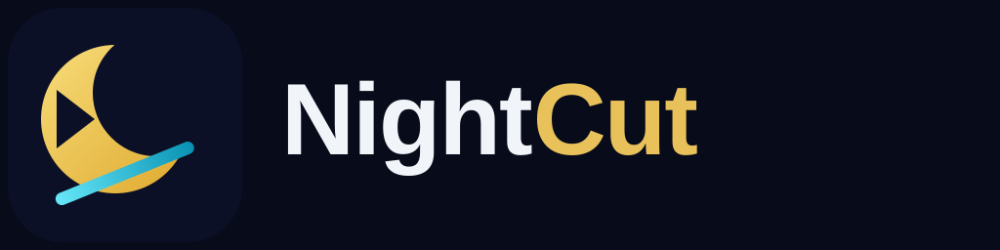
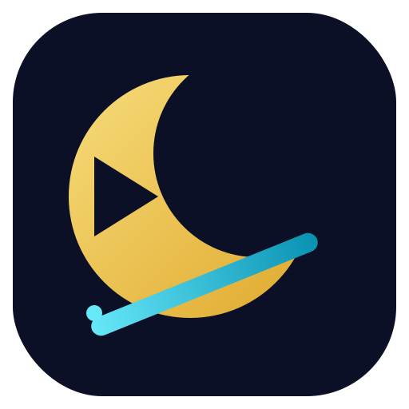

<p align="center">
  
</p>

<p align="center">
  <strong>Open-source video editor for creators and community — by TheOwlOps</strong><br/>
  A lightweight, local-first alternative to subscription editors: cut, caption,
  add music and export — no cloud, no watermark, no monthly fee.
</p>



## Why NightCut?

Subscription video editors keep moving basic features behind a paywall.
NightCut covers the features creators actually use every day, runs fully on
your machine, and stays small:

- **Non-destructive timeline** — projects are plain JSON metadata; editing
  never re-encodes your footage, only export does.
- **Proxy workflow** — a light 720p proxy is generated on import, so scrubbing
  stays smooth even with 4K sources.
- **Real export** — the timeline compiles to an FFmpeg filter graph and
  encodes with hardware acceleration when available (NVENC / QuickSync /
  VideoToolbox), falling back to libx264.
- **Lightweight shell** — Tauri + Rust instead of Electron: a ~15MB-class
  installer, no bundled Chromium, no Python runtime.

## Status — Phase 0 (this repo right now)

- [x] Rust workspace: `editor-core` (timeline model, trim/split/move,
      undo/redo), `media-engine` (ffprobe, proxy, thumbnails, waveform),
      `export-engine` (timeline → FFmpeg graph → MP4) — all unit-tested
- [x] Desktop/web editor UI: import, preview with text overlays, timeline
      drag/trim/split, inspector, canvas presets (9:16 / 16:9 / 1:1),
      undo/redo, project JSON open/save, export panel
- [x] Effects library (11 effects): brightness/contrast/saturation, grayscale,
      sepia, blur, sharpen, vignette, warm/cool temperature, mirror, invert,
      fade in/out — modelled in editor-core, rendered by export-engine as real
      FFmpeg filters, approximated live in the preview, sliders in the Inspector
- [x] Tauri 2 shell with native `probe_media` / `make_proxy` / `waveform` /
      `export_video` commands wired to the Rust crates
- [x] Wave 2 (CapCut study, see docs/CAPCUT-STUDY.md): CapCut-style left dock
      (Media / Text / Effects / Filters / Transitions / Audio / Captions),
      transitions between clips via FFmpeg xfade (12 presets), speed + volume
      per clip, text style presets + colors, .srt caption import, filter
      presets, reverse effect, timeline magnet snapping
- [x] Wave 3: speed curve presets, keyframe animation (scale/rotate/opacity),
      freeze frame, chroma key (green screen), audio denoise, local templates
- [x] Wave 4: shape masks (rect/circle), two-pass stabilization (vidstab),
      local auto-captions via whisper.cpp, native desktop file picker
      (real paths for probe/export/captions), timeline thumbnails +
      waveforms, voiceover recording
- [ ] Phase 1 leftovers: music mixing polish in UI
- [ ] Phase 2 (the "smooth like the big editors" phase): proxy cache,
      thumbnail/waveform rendering on the timeline, pre-render around playhead
- [ ] Phase 3: local auto-captions (whisper.cpp, optional download), LUTs,
      keyframes, shareable templates

Full design notes: [docs/BLUEPRINT.md](docs/BLUEPRINT.md)

## Layout

```
apps/desktop/          Tauri 2 + React + TypeScript editor
  src/                 UI (MediaBin / Preview / Timeline / Inspector / Export)
  src-tauri/           Rust shell — thin commands over the core crates
crates/editor-core/    Timeline model + project JSON schema + undo/redo
crates/media-engine/   ffprobe, proxy, thumbnails, waveform peaks
crates/export-engine/  Project → FFmpeg filter graph → encode
assets/                Logo (SVG master + PNG)
tools/ffmpeg/          How the FFmpeg sidecar is fetched (not bundled)
```

## Develop

Requirements: Node 20+, Rust stable, FFmpeg on PATH (for the engines).

```sh
# Core engines — no GUI deps needed
cargo test

# Editor UI in a browser
cd apps/desktop && npm install && npm run dev   # http://localhost:1420

# Desktop app (needs Tauri system deps for your OS)
npm run tauri dev
```

## Logo

The mark is a golden crescent moon (**Night**) sliced by a cyan edit cut
(**Cut**), with a play button carved into the moon. Masters live in
[`assets/`](assets/): `logo.svg` (app icon), `logo-wordmark.svg` (header).

## License

MIT
